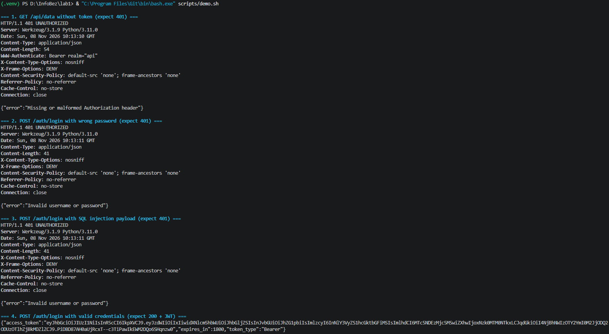
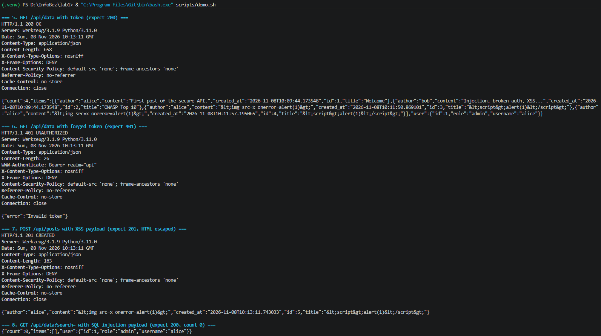
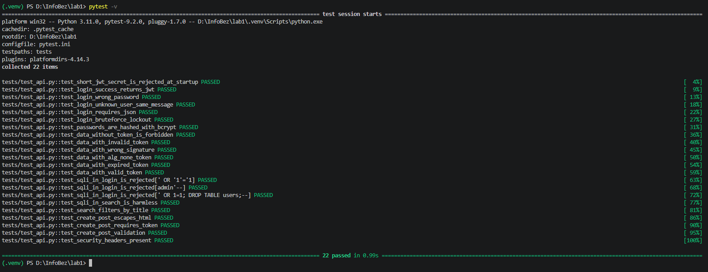
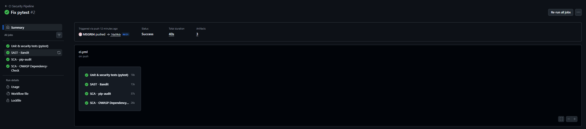
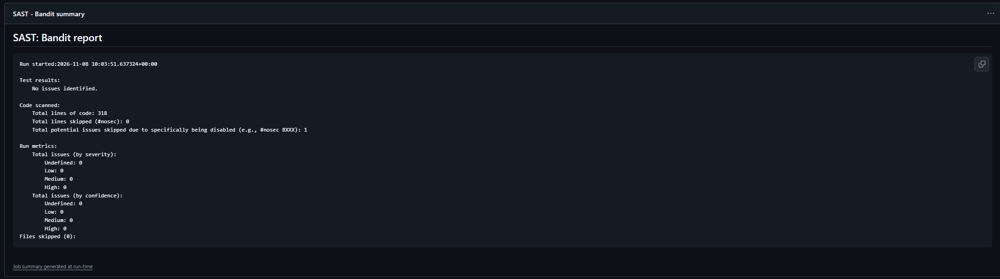
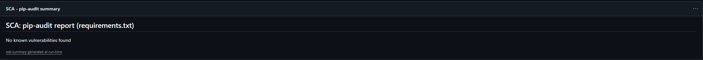
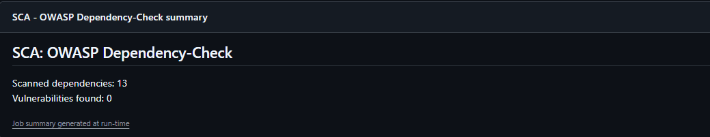

# Лабораторная работа 1. Защищённый REST API с интеграцией в CI/CD


Учебный backend на **Python 3.11 + Flask**: аутентификация по JWT, хранение данных в SQLite через ORM SQLAlchemy, защита от SQL-инъекций, XSS и атак на аутентификацию. При каждом `push` и `pull request` GitHub Actions прогоняет тесты, SAST (Bandit) и SCA (pip-audit, OWASP Dependency-Check).

- Репозиторий: `https://github.com/<USER>/<REPO>`
- Последний успешный pipeline: `https://github.com/<USER>/<REPO>/actions/runs/<RUN_ID>`

## Содержание

1. [Стек и структура проекта](#1-стек-и-структура-проекта)
2. [Запуск](#2-запуск)
3. [Описание API](#3-описание-api)
4. [Реализованные меры защиты](#4-реализованные-меры-защиты)
5. [CI/CD pipeline](#5-cicd-pipeline)
6. [Тестирование](#6-тестирование)
7. [Отчёты SAST/SCA (скриншоты)](#7-отчёты-sastsca-скриншоты)
8. [Ответы на контрольные вопросы](#8-ответы-на-контрольные-вопросы)

## 1. Стек и структура проекта

| Компонент | Технология |
|---|---|
| Язык / фреймворк | Python 3.11, Flask 3.1 |
| База данных | SQLite через ORM Flask-SQLAlchemy / SQLAlchemy 2.1 |
| Хэширование паролей | bcrypt (cost factor 12, уникальная соль) |
| Токены | JWT (PyJWT), HS256, срок жизни 30 минут |
| Экранирование вывода | MarkupSafe `escape()` (используется Flask/Jinja2) |
| Тесты | pytest (22 теста) |
| SAST | Bandit |
| SCA | pip-audit, OWASP Dependency-Check |

```
.
├── app/
│   ├── __init__.py      # фабрика приложения, обработчики ошибок, демо-данные
│   ├── config.py        # настройки из переменных окружения
│   ├── models.py        # ORM-модели User, Post + bcrypt
│   ├── routes.py        # эндпоинты /auth/login, /api/data, /api/posts
│   └── security.py      # JWT, middleware jwt_required, sanitize, защита от перебора
├── tests/test_api.py    # функциональные тесты и тесты безопасности
├── scripts/demo.sh      # демонстрация API через curl
├── .github/workflows/ci.yml
├── requirements.txt     # зафиксированные версии зависимостей
└── requirements-dev.txt # + pytest, bandit, pip-audit
```

## 2. Запуск

```bash
python -m venv .venv
source .venv/bin/activate        # Windows: .venv\Scripts\activate
pip install -r requirements-dev.txt
export JWT_SECRET="длинная-случайная-строка"   # Windows PowerShell: $env:JWT_SECRET="..."
python run.py                    # http://127.0.0.1:5000
```

При первом запуске создаётся БД `instance/app.db` с демо-пользователями:

| Логин | Пароль (по умолчанию, меняется через `.env`) | Роль |
|---|---|---|
| `alice` | `Alice_Passw0rd!` | admin |
| `bob` | `Bob_Passw0rd!` | user |

Пароли задаются переменными `DEMO_ALICE_PASSWORD` / `DEMO_BOB_PASSWORD` (см. `.env.example`), в БД хранятся только bcrypt-хэши.

## 3. Описание API

Все запросы и ответы — JSON. Защищённые методы требуют заголовок `Authorization: Bearer <token>`.

### `POST /auth/login` — аутентификация

```bash
curl -X POST http://127.0.0.1:5000/auth/login \
  -H "Content-Type: application/json" \
  -d '{"username":"alice","password":"Alice_Passw0rd!"}'
```

| Код | Когда | Тело |
|---|---|---|
| 200 | верные логин и пароль | `{"access_token":"eyJ...","token_type":"Bearer","expires_in":1800}` |
| 400 | не JSON, поля не строки, недопустимая длина | `{"error":"..."}` |
| 401 | неверный логин **или** пароль (одно сообщение) | `{"error":"Invalid username or password"}` |
| 429 | 5 неудачных попыток за 15 минут | `{"error":"Too many failed attempts, try again later"}` |

### `GET /api/data` — список постов (только с токеном)

Необязательный параметр `?search=` фильтрует по заголовку.

```bash
curl http://127.0.0.1:5000/api/data -H "Authorization: Bearer $TOKEN"
curl "http://127.0.0.1:5000/api/data?search=owasp" -H "Authorization: Bearer $TOKEN"
```

```json
{
  "user": {"id": 1, "username": "alice", "role": "admin"},
  "count": 2,
  "items": [
    {"id": 1, "title": "Welcome", "content": "First post of the secure API.", "author": "alice", "created_at": "..."}
  ]
}
```

Без токена, с поддельным или просроченным токеном возвращается `401`.

### `POST /api/posts` — создание поста (собственный метод, только с токеном)

```bash
curl -X POST http://127.0.0.1:5000/api/posts \
  -H "Authorization: Bearer $TOKEN" -H "Content-Type: application/json" \
  -d '{"title":"<script>alert(1)</script>","content":"Hello"}'
```

Ответ `201`, HTML в ответе экранирован:

```json
{"id": 3, "title": "&lt;script&gt;alert(1)&lt;/script&gt;", "content": "Hello", "author": "alice", "created_at": "..."}
```

Автор берётся из проверенного токена, а не из тела запроса. `title` — 1..120 символов, `content` — 1..5000.

### `GET /health` — проверка работоспособности (без аутентификации)

## 4. Реализованные меры защиты

### 4.1. SQL-инъекции (OWASP A03:2021 Injection)

- Все обращения к БД идут через ORM SQLAlchemy; SQL-строки нигде не собираются конкатенацией. ORM передаёт значения в драйвер как **связанные параметры** (prepared statement), поэтому ввод пользователя всегда остаётся данными и не может стать частью SQL-кода:
  ```python
  # routes.py — логин
  db.select(User).filter_by(username=username)
  # SQL: SELECT ... FROM users WHERE users.username = ?   параметры: ("' OR '1'='1",)
  ```
- В поиске `?search=` дополнительно экранируются LIKE-метасимволы `%` и `_`, чтобы пользователь не мог подставить свой шаблон:
  ```python
  pattern = search.replace("\\", "\\\\").replace("%", "\\%").replace("_", "\\_")
  query = query.where(Post.title.ilike(f"%{pattern}%", escape="\\"))
  ```
- Проверяется тип и длина входных данных.
- Тесты: `test_sqli_in_login_is_rejected` (payload `' OR '1'='1`, `admin'--`, `'; DROP TABLE users;--`), `test_sqli_in_search_is_harmless`.

### 4.2. XSS (Cross-Site Scripting)

- Все пользовательские данные перед отправкой в ответе проходят через функцию `sanitize()` (`app/security.py`). Она рекурсивно применяет `markupsafe.escape()` (тот же механизм, которым Flask/Jinja2 экранирует шаблоны) и заменяет `< > & ' "` на HTML-сущности:
  ```python
  def sanitize(value):
      if isinstance(value, str):
          return str(escape(value))
      ...
  ```
  `<script>alert(1)</script>` → `&lt;script&gt;alert(1)&lt;/script&gt;`.
- В БД данные хранятся как есть, экранируются при выводе: так рекомендует OWASP XSS Prevention Cheat Sheet (кодировать под контекст вывода).
- Ответы отдаются с `Content-Type: application/json` и заголовками, запрещающими браузеру интерпретировать их как HTML:
  `X-Content-Type-Options: nosniff`, `Content-Security-Policy: default-src 'none'; frame-ancestors 'none'`, `X-Frame-Options: DENY`, `Referrer-Policy: no-referrer`, `Cache-Control: no-store`.
- Тесты: `test_create_post_escapes_html`, `test_security_headers_present`.

### 4.3. Аутентификация (OWASP A07:2021, A01:2021)

**Хэширование паролей.** Пароли хранятся только как bcrypt-хэш (`$2b$12$...`), с уникальной случайной солью и cost factor 12 (`User.set_password`). Проверка — `bcrypt.checkpw`, которая сравнивает хэши за постоянное время. Длина пароля ограничена 72 байтами (больше bcrypt не учитывает).

**Выдача JWT.** После успешного входа `create_access_token()` подписывает токен алгоритмом HS256 секретом из переменной окружения `JWT_SECRET` (если она не задана, при старте генерируется случайный секрет; секрет короче 32 байт приложение не принимает и не запускается). Payload:

```json
{"sub": "1", "username": "alice", "role": "admin", "iss": "secure-api-lab1",
 "iat": 1767000000, "exp": 1767001800, "jti": "4f1c..."}
```

**Middleware `jwt_required`** (`app/security.py`) — декоратор, который висит на всех защищённых эндпоинтах:
1. проверяет, что заголовок имеет вид `Authorization: Bearer <token>`;
2. `jwt.decode()` проверяет подпись, `exp` (срок жизни), `iss` и наличие обязательных claim'ов;
3. список алгоритмов зафиксирован (`algorithms=["HS256"]`), поэтому токены с `"alg": "none"` и атаки подмены алгоритма отклоняются;
4. проверяет, что пользователь из `sub` по-прежнему есть в БД;
5. кладёт пользователя в `g.current_user`; иначе возвращает `401` с `WWW-Authenticate: Bearer`.

**Дополнительно:**
- одинаковое сообщение и одинаковое время ответа для «нет такого пользователя» и «неверный пароль»: для несуществующего пользователя тоже выполняется bcrypt-проверка (на dummy-хэше). Так нельзя перебором выяснить, какие логины существуют;
- защита от перебора паролей: после 5 неудачных попыток за 15 минут для пары (IP, логин) возвращается `429`;
- `debug=False` и сервер слушает только `127.0.0.1`; обработчики ошибок не отдают клиенту stack trace;
- ограничение размера тела запроса — 16 КБ.

Тесты: `test_login_*`, `test_passwords_are_hashed_with_bcrypt`, `test_data_without_token_is_forbidden`, `test_data_with_invalid_token`, `test_data_with_wrong_signature`, `test_data_with_alg_none_token`, `test_data_with_expired_token`, `test_login_bruteforce_lockout`.

## 5. CI/CD pipeline

Файл: [`.github/workflows/ci.yml`](.github/workflows/ci.yml). Запускается на каждый `push`, `pull_request` и вручную (`workflow_dispatch`). Четыре параллельных job'а:

| Job | Тип | Что делает | Когда падает |
|---|---|---|---|
| `tests` | — | `pytest -v` | упал хотя бы один тест |
| `sast-bandit` | SAST | Bandit сканирует `app/` и `run.py`, HTML/JSON-отчёт → artifact, текстовый отчёт → Summary | найдена проблема уровня Medium/High |
| `sca-pip-audit` | SCA | pip-audit проверяет `requirements.txt` по базе PyPI Advisory / OSV, отчёт → Summary и artifact | у зависимости есть известная уязвимость |
| `sca-dependency-check` | SCA | OWASP Dependency-Check (NVD), отчёт HTML/JSON/SARIF → artifact, таблица → Summary | CVSS ≥ 7 (job информационный, `continue-on-error`) |

Отчёты видны в двух местах: **Actions → запуск → Summary** (таблицы и текст) и **Artifacts** внизу страницы запуска (`bandit-report`, `pip-audit-report`, `dependency-check-report`).

### Найденное и исправленное

Первый запуск Bandit нашёл одну проблему:

```
>> Issue: [B105:hardcoded_password_string] Possible hardcoded password: 'Bearer'
   Severity: Low   Confidence: Medium
   Location: app/routes.py:79   "token_type": "Bearer",
```

Это ложное срабатывание: `"Bearer"` — название схемы токена (RFC 6750), а не пароль. Строка помечена `# nosec B105` с пояснением. Секреты (JWT-ключ, пароли демо-пользователей) берутся из переменных окружения. После этого Bandit: **0 issues**. pip-audit: **No known vulnerabilities found**, все версии зависимостей зафиксированы в `requirements.txt`.

OWASP Dependency-Check при первом запуске в CI нашёл уязвимость в зависимости:

```
requirements.txt (pkg:pypi/pyjwt@2.15.1): CVE-2025-45770 (CVSS 7.0)
```

Разбор: запись имеет статус **Disputed**. Её суть — PyJWT не проверяет длину ключа и оставляет это приложению (CWE-326). Поэтому проверка добавлена в приложение: `create_app()` не запускается, если `JWT_SECRET` короче 32 байт (минимум для HS256 по RFC 7518), это покрыто тестом `test_short_jwt_secret_is_rejected_at_startup`. После этого CVE подавлена в [`dependency-check-suppressions.xml`](dependency-check-suppressions.xml) с обоснованием. Подавление действует только для версии 2.15.1 и до 2027-05-01, затем решение нужно пересмотреть.

Также в CI падал job `tests` с ошибкой `ModuleNotFoundError: No module named 'app'`: команда `pytest` не добавляет корень проекта в путь импорта. Исправлено настройкой `pythonpath = .` в `pytest.ini`.

## 6. Тестирование

### Автотесты

```bash
pytest -v
```

22 теста: проверка длины секрета JWT, успешный и неуспешный вход, доступ без токена / с поддельным / просроченным / `alg:none` токеном, bcrypt-хэш в БД, SQL-инъекции в логине и поиске, экранирование XSS, блокировка перебора, заголовки безопасности.

### Ручная проверка через curl

```bash
python run.py          # терминал 1
bash scripts/demo.sh   # терминал 2 (Git Bash на Windows)
```

| # | Запрос | Ожидаемо |
|---|---|---|
| 1 | `GET /api/data` без токена | `401 Missing or malformed Authorization header` |
| 2 | логин с неверным паролем | `401 Invalid username or password` |
| 3 | логин с `' OR '1'='1' --` | `401` (инъекция не сработала) |
| 4 | логин `alice` / `Alice_Passw0rd!` | `200`, JWT |
| 5 | `GET /api/data` с токеном | `200`, список постов |
| 6 | `GET /api/data` с изменённым токеном | `401 Invalid token` |
| 7 | `POST /api/posts` с `<script>` | `201`, `&lt;script&gt;...` |
| 8 | `GET /api/data?search=' OR '1'='1` | `200`, `count: 0` |





## 7. Отчёты SAST/SCA (скриншоты)

Успешный запуск pipeline (все job'ы зелёные):



SAST — Bandit (No issues identified):



SCA — pip-audit (No known vulnerabilities found):



SCA — OWASP Dependency-Check:



## 8. Ответы на контрольные вопросы

**1. Почему bcrypt предпочтительнее SHA-256 для паролей?**
SHA-256 создан, чтобы быть быстрым: GPU перебирает миллиарды хэшей в секунду, поэтому утёкшую базу хэшей паролей быстро взламывают словарём и перебором. bcrypt специально медленный, а его cost factor можно увеличивать вместе с ростом мощности железа (2^12 раундов здесь). Он требует заметно больше памяти, что мешает распараллеливанию на GPU/ASIC, и автоматически добавляет уникальную соль к каждому паролю. Поэтому радужные таблицы бесполезны, а одинаковые пароли дают разные хэши. Соль и параметры хранятся прямо в строке хэша.

**2. Чем SAST отличается от DAST?**
SAST (white-box) анализирует исходный код, байт-код или зависимости без запуска приложения. Работает рано, прямо в CI, указывает на конкретную строку кода, но даёт ложные срабатывания и не видит проблем окружения и конфигурации. DAST (black-box) атакует запущенное приложение снаружи через HTTP, как это делал бы злоумышленник (OWASP ZAP, Burp). Находит реальные эксплуатируемые проблемы: конфигурацию, заголовки, аутентификацию на работающем сервере. Но нужен развёрнутый стенд, и DAST не показывает, где в коде ошибка. Подходы дополняют друг друга.

**3. Как работает JWT?**
JWT — строка `header.payload.signature`, каждая часть в Base64URL. Header содержит алгоритм (`{"alg":"HS256","typ":"JWT"}`). Payload — claims: `sub` (id пользователя), `exp` (срок жизни), `iat` (время выдачи), `iss` (издатель), `jti` (id токена), роль и т. п. Payload **не шифруется**, только кодируется, поэтому секреты туда класть нельзя. Signature = HMAC-SHA256(`header.payload`, секрет сервера). Сервер выдаёт токен при логине, клиент присылает его в `Authorization: Bearer`. Чтобы проверить токен, сервер заново считает подпись своим секретом и сравнивает с присланной: если payload изменили, подпись не совпадёт. Затем сервер проверяет `exp`/`iss`/обязательные поля и то, что алгоритм входит в разрешённый список (защита от `alg: none`). Состояние сессии на сервере не хранится (stateless).

**4. Чем опасно отсутствие аудита зависимостей?**
Большая часть кода приложения — сторонние библиотеки, и их уязвимости становятся уязвимостями приложения (OWASP A06:2021 Vulnerable and Outdated Components). Пример — Log4Shell. Риски: удалённое выполнение кода, утечка данных, DoS, атаки на цепочку поставок (вредоносные или захваченные пакеты, typosquatting, dependency confusion), транзитивные зависимости, о которых разработчик даже не знает, а также лицензионные риски. Без SCA в CI о публично известной CVE можно не узнать, пока её не используют злоумышленники.
